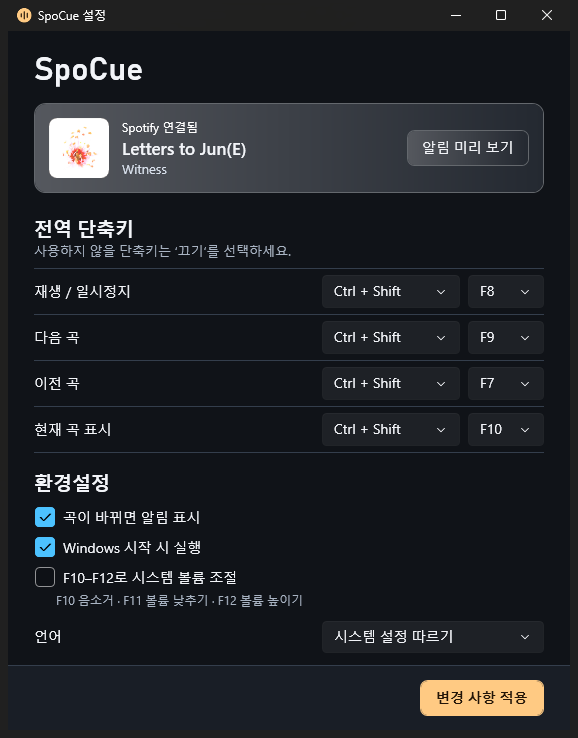

<p align="center">
  
</p>

<h1 align="center">SpoCue</h1>

<p align="center">
  <strong>어느 창에서나 바로 쓰는 Spotify 단축키, Spotify 단독 볼륨 조절, 앨범 색을 따라가는 곡 알림 토스트</strong>
</p>

<p align="center">
  <a href="https://apps.microsoft.com/detail/9N85N2516FLS"></a>
</p>

<p align="center">
  <a href="https://github.com/isnow890/spocue/actions/workflows/build.yml"></a>
  <a href="https://github.com/isnow890/spocue/releases/latest"></a>
  
  
  <a href="LICENSE"></a>
</p>

<p align="center">
  <a href="README.md">English</a> · <strong>한국어</strong>
</p>

---

## 왜 만들었나요?

예전에 **Toastify**를 써보셨다면 코딩이나 게임을 하다가 창을 바꾸지 않고 단축키로 Spotify 곡을 넘기던 편리함을 기억하실 겁니다. 하지만 Toastify는 최신 Spotify 버전에서 더 이상 동작하지 않고, 미디어 전용 키가 없는 텐키리스·커스텀 키보드에서는 기본 미디어 키를 쓰기도 어렵습니다.

**SpoCue**는 최신 Windows 10/11과 현행 Spotify 데스크톱 앱에서 바로 쓸 수 있도록 **순수 C# / WPF**로 가볍게 만든 트레이 앱입니다. 무거운 Electron도, 번거로운 Spotify 개발자 API 키 발급이나 로그인도 필요 없습니다.

- **어디서나 먹는 전역 단축키**: 작업 중인 창을 벗어나지 않고 **재생 / 일시정지**, **다음 곡**, **이전 곡**, **현재 곡 보기**, **Spotify 단독 볼륨 조절**(`Ctrl + Shift + Up/Down`), **현재 곡 정보 복사**(`Ctrl + Shift + C`)를 실행합니다. 단축키 줄마다 있는 **체크박스**로 원하는 기능만 한 번에 켜고 끌 수 있으며, 다른 프로그램이 이미 쓰는 키와 겹치면 기존 설정을 그대로 유지해 단축키가 중간에 꼬이지 않습니다.
- **게임 소리는 그대로 두는 Spotify 단독 볼륨 조절**: Windows CoreAudio(`ISimpleAudioVolume`)로 **`Spotify.exe` 앱 볼륨만 5% 단위로** 따로 올리고 내립니다. 게임이나 디스코드, 브라우저 소리는 건드리지 않고 배경음악 크기만 줄이고 싶을 때 바로 쓸 수 있습니다. 스피커, 헤드셋, Windows 앱별 출력 설정 등 Spotify가 어느 출력 장치로 나가든 찾아서 조절하고, 토스트에 볼륨 막대가 함께 표시됩니다.
- **앨범 커버 색을 따라가는 2줄 토스트 알림**:
  - 재생 중인 앨범 커버에서 색을 뽑아(`ArtworkPalette`) 토스트 배경과 설정창 카드 색을 자연스럽게 맞춥니다.
  - 곡이 바뀔 때 선택한 화면 모서리(**우측 하단 / 우측 상단 / 좌측 하단 / 좌측 상단**)에 4초 동안 떴다 사라지며, 긴 곡 제목도 잘리지 않도록 **깔끔하게 두 줄까지** 표시합니다. 현재 타이핑 중이거나 게임 중인 창의 포커스는 빼앗지 않습니다.
  - **좌클릭으로 Spotify 열기 · 우클릭으로 곡 복사**: 토스트를 **좌클릭**하면 뒤에 숨어 있던 Spotify 창을 앞으로 불러오고, **우클릭**하면 `아티스트 - 곡 제목`을 클립보드에 바로 복사합니다.
- **로그인도, API 키도 필요 없음**: Windows 기본 미디어 세션(SMTC)으로 Spotify 데스크톱 앱(`Spotify.exe` 및 Microsoft Store 버전)과 직접 통신합니다.
- **윈도우 시작 시 자동 실행 · 한국어/영어 지원 · 업데이트 확인**: 부팅할 때 트레이에 조용히 자동 실행되도록 설정할 수 있고, 하루 한 번 GitHub Releases의 새 버전을 확인해 알려줍니다(설정에서 끄거나 트레이 우클릭 메뉴에서 수동 확인 가능).

<p align="center">
  
</p>

<p align="center">
  
</p>

### 한눈에 비교

| 기능 | SpoCue | 예전 Toastify | Windows 기본 미디어 오버레이 |
| :--- | :---: | :---: | :---: |
| 최신 Spotify 데스크톱(설치형 & Store) 동작 | ✅ | ⚠️ (최신 버전 미동작) | ✅ |
| 미디어 키 없는 키보드에서 원하는 단축키 지정 | ✅ | ✅ | — |
| 게임 소리는 놔두고 Spotify 앱 볼륨만 단독 조절 | ✅ | ✅ | — |
| 단축키 또는 토스트 우클릭으로 현재 곡 제목 복사 | ✅ | ✅ | — |
| 단축키 충돌 시 기존 단축키 안전 유지 | ✅ | — | — |
| 포커스를 안 뺏는 앨범 커버 색상 토스트 | ✅ | — | — |
| 토스트 클릭 시 Spotify 창 바로 띄우기 | ✅ | ✅ | — |
| API 키 불필요, 외부 라이브러리 0, MIT 오픈소스 | ✅ | ✅ (MIT) | 비공개 |

---

## 설치 방법

### 방법 1: Microsoft Store (권장)

[Microsoft Store](https://apps.microsoft.com/detail/9N85N2516FLS)에서 SpoCue를 설치합니다. Store가 패키지에 서명하고 업데이트도 알아서 설치해 줍니다.

### 방법 2: 설치 프로그램 (`Setup.exe`)

1. [Releases](https://github.com/isnow890/spocue/releases/latest)에서 `spocue-vX.Y.Z-win-x64-setup.exe`를 받습니다.
2. 실행하면 관리자 권한 창 없이 `%LOCALAPPDATA%\Programs\SpoCue`에 설치되고, 시작 메뉴 바로가기와 Windows '설치된 앱' 제거 항목이 등록됩니다.
3. 설치 마지막 화면에서 바로 실행하거나 시작 메뉴에서 **SpoCue**를 엽니다.

### 방법 3: 무설치 포터블 (`.zip`)

1. [Releases](https://github.com/isnow890/spocue/releases/latest)에서 `spocue-vX.Y.Z-win-x64.zip`을 받습니다.
2. 원하는 폴더에 압축을 풀고 `SpoCue.exe`를 실행합니다. 설치본과 포터블 모두 .NET 10 런타임이 들어 있어 따로 설치할 것이 없습니다.

### 방법 4: 소스 코드로 직접 빌드

Windows 10 (2004 이상) 또는 Windows 11, 그리고 [.NET 10 SDK](https://dotnet.microsoft.com/download/dotnet/10.0)가 필요합니다.

```powershell
git clone https://github.com/isnow890/spocue.git
cd spocue

dotnet build TrackRelay.slnx -c Release
dotnet run --project src/TrackRelay/TrackRelay.csproj -- --settings
```

설치 프로그램(`Setup.exe`)과 포터블 `.zip`, `SHA256SUMS.txt` 패키징 (Inno Setup 6 필요):

```powershell
powershell -ExecutionPolicy Bypass -File 배포/패키지-빌드.ps1 -Version 0.5.1
```

---

## 첫 실행과 기본 단축키

처음 실행하면 설정 창이 열리고 작업 표시줄 우측 트레이(숨겨진 아이콘 `^` 안쪽)에 파형 아이콘이 생깁니다. 설정 창을 닫아도 앱은 종료되지 않고 트레이에 남아 있으며, 트레이 아이콘을 더블 클릭하거나 우클릭해서 언제든 설정을 다시 열 수 있습니다.

| 기능 | 기본 단축키 | 변경 가능한 키 |
| :--- | :--- | :--- |
| **재생 / 일시정지** | `Ctrl + Shift + F8` | 체크박스 켜기/끄기 + `Ctrl+Alt`, `Ctrl+Shift`, `Alt+Shift`, `Ctrl+Alt+Shift`, `Win+Shift` + `F1`~`F12`, 방향키, `A`~`Z`, `0`~`9` |
| **다음 곡** | `Ctrl + Shift + F9` | 위와 같음 |
| **이전 곡** | `Ctrl + Shift + F7` | 위와 같음 |
| **현재 곡 표시** | `Ctrl + Shift + F10` | 곡 변경 자동 알림을 꺼 두었을 때도 누르면 바로 현재 곡 토스트를 4초간 띄움 |
| **Spotify 볼륨 높이기** | `Ctrl + Shift + Up` | 다른 프로그램 소리는 그대로 두고 Spotify 앱 볼륨만 5% 높임 |
| **Spotify 볼륨 낮추기** | `Ctrl + Shift + Down` | 다른 프로그램 소리는 그대로 두고 Spotify 앱 볼륨만 5% 낮춤 |
| **현재 곡 정보 복사** | `Ctrl + Shift + C` | `아티스트 - 곡 제목`을 클립보드에 복사 (토스트 **우클릭** 또는 트레이 메뉴에서도 가능) |

---

## 실행 옵션 & 설정 경로

```powershell
# 실행하면서 설정 창 바로 열기
SpoCue.exe --settings

# 창을 띄우지 않고 트레이로만 조용히 시작 ('Windows 시작 시 실행'에서 사용)
SpoCue.exe --startup
```

- **설정 저장 위치**: `%LOCALAPPDATA%\SpoCue\settings.json`
- **자동 시작 레지스트리**: `HKCU\Software\Microsoft\Windows\CurrentVersion\Run` (`SpoCue`)

---

## 참고 사항 및 FAQ

1. **개인정보 수집 없음 & 업데이트 확인 안내**: 곡 제목과 앨범 커버 썸네일은 재생 중에만 메모리에 들고 있고, 파일로는 단축키·옵션 설정(`settings.json`)만 저장합니다. *"자동으로 업데이트 확인"*이 켜져 있을 때만 하루 1회 `https://api.github.com/repos/isnow890/spocue/releases/latest`에서 최신 버전 번호를 조회하며, 설정에서 언제든 끌 수 있습니다.
2. **Spotify 데스크톱 앱 전용**: 유튜브 같은 브라우저 영상이 음악 단축키에 반응하지 않도록 Spotify 데스크톱 앱(`Spotify.exe` 및 Store 버전)만 골라서 연결합니다. 웹 브라우저에서 띄운 Spotify 웹 플레이어는 지원하지 않습니다.
3. **포터블 폴더 위치 이동**: 포터블 버전에서 *Windows 시작 시 실행*을 켜면 그때 실행한 `SpoCue.exe` 경로가 등록됩니다. 나중에 폴더 위치를 옮겼다면 설정에서 자동 실행을 한 번 껐다 켜 주세요 (`Setup.exe`로 설치했다면 고정 경로라 신경 쓰지 않아도 됩니다).

<details>
<summary><strong>자주 묻는 질문 (문제 해결)</strong></summary>

- **Spotify를 켜 뒀는데 *"Spotify 대기 중"*이라고만 나옵니다**: Spotify에서 아무 곡이나 한 번 재생하면 Windows 미디어 세션이 연결되면서 *"Spotify 연결됨"*으로 바뀝니다. Spotify 설정에서 *'미디어 키를 사용할 때 데스크톱 오버레이 표시'*가 켜져 있는지도 확인해 주세요.
- **단축키를 적용하려는데 *"사용할 수 없습니다"*라고 나옵니다**: Windows 전역 단축키는 먼저 등록한 프로그램이 독점합니다. GeForce 오버레이, PowerToys, 화면 캡처 프로그램 등이 이미 같은 키를 쓰고 있는지 확인하거나 다른 키 조합으로 바꿔 주세요.
- **곡이 바뀌어도 토스트가 안 뜹니다**: 설정의 *"곡이 바뀌면 알림 표시"*가 켜져 있는지 확인하세요. SpoCue를 켰을 때 이미 재생 중이던 첫 곡은 시작 기준으로만 삼고, 그다음 곡으로 넘어갈 때부터 토스트가 뜹니다. 지금 바로 보고 싶다면 **알림 미리 보기** 버튼을 누르거나 `Ctrl + Shift + F10`을 눌러 보세요.
- **토스트를 눌러도 Spotify 창이 앞으로 안 나옵니다**: Spotify가 완전히 종료되었거나 메인 창 없이 트레이로만 숨어 있으면 창을 불러올 수 없습니다. Spotify 창을 한 번 열어 둔 상태에서는 최소화되어 있어도 바로 앞으로 올라옵니다.

</details>

---

## 프로젝트 구조

```text
src/TrackRelay/
├── App.xaml(.cs)             # 중복 실행 방지, 트레이 아이콘, 다크 테마 및 고대비 모드 처리
├── SpotifySession.cs         # Windows 미디어 세션(SMTC) 연결, 재생 제어, 앨범 커버 로드
├── SpotifyVolume.cs          # Windows CoreAudio (ISimpleAudioVolume) 기반 Spotify 단독 볼륨 제어
├── SpotifyWindow.cs          # Spotify.exe 창 핸들 찾기 및 앞으로 가져오기
├── GlobalHotkeys.cs          # Win32 RegisterHotKey 등록 및 충돌 시 이전 설정 복구
├── ArtworkPalette.cs         # 앨범 커버 색상 추출 및 토스트 배경·강조색 계산
├── ArtworkBadge.xaml(.cs)    # 앨범 커버 썸네일 및 기본 파형 아이콘 컨트롤
├── TrackToast.xaml(.cs)      # 포커스를 빼앗지 않는 4초 곡 알림 토스트 창
├── SettingsWindow.xaml(.cs)  # 현재 곡 미리보기 카드, 체크박스 단축키 설정 및 옵션 창
├── StartupRegistration.cs    # Windows 시작프로그램(HKCU Run) 등록/해제
├── Preferences.cs            # %LOCALAPPDATA%\SpoCue\settings.json 읽기/쓰기
├── Strings.cs                # 한국어 / 영어 문구 및 실시간 언어 전환
├── Theme.xaml                # 기본 색상 팔레트 및 버튼·카드 스타일
└── UpdateChecker.cs          # GitHub Releases 최신 버전 확인 (일일 자동 확인 및 트레이 수동 확인)
```

---

## 코드 서명 정책 (Code Signing Policy)

무료 코드 서명은 [SignPath.io](https://signpath.io/)에서 제공하며, 인증서는 [SignPath Foundation](https://signpath.org/)에서 발급합니다.

- **작성자, 리뷰어 및 승인자 (Authors, Reviewers, and Approvers)**: [@isnow890](https://github.com/isnow890)
- **개인정보 보호 정책**: 이 프로그램은 사용자 또는 설치·운영자가 명시적으로 요청하지 않는 한(선택적인 GitHub Releases 최신 버전 확인 제외) 외부 네트워크 시스템으로 어떠한 정보도 전송하지 않습니다.

---

## 라이선스

[MIT License](LICENSE). 옛 [Toastify](https://github.com/nachmore/toastify)에서 아이디어를 얻어 새로 만든 프로젝트입니다.

## 상표 고지

SpoCue는 개인이 만든 독립 프로젝트로, Spotify AB와 제휴하거나 보증·후원을 받지 않았습니다. Spotify는 Spotify AB의 상표이며, 이 문서에서는 SpoCue가 어떤 앱과 함께 동작하는지 설명하는 용도로만 사용합니다.
