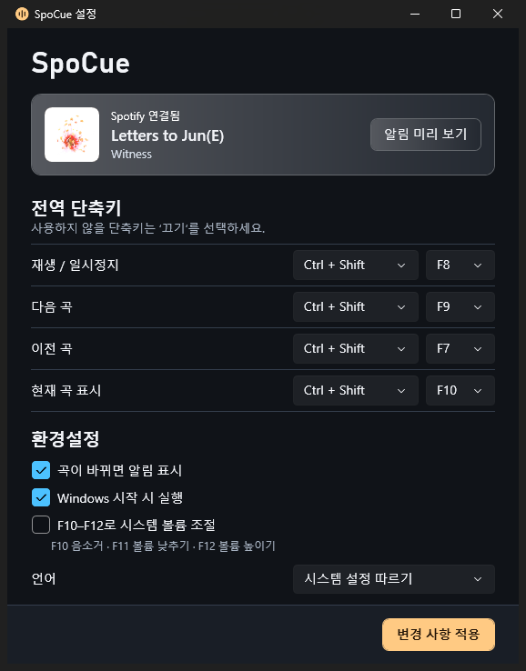

<p align="center">
  
</p>

<h1 align="center">SpoCue</h1>

<p align="center">
  <strong>Lightweight native Windows tray app for Spotify global hotkeys, album-tinted track toasts &amp; F10–F12 volume keys.</strong>
</p>

<p align="center">
  <a href="https://github.com/isnow890/spocue/actions/workflows/build.yml"></a>
  <a href="https://github.com/isnow890/spocue/releases/latest"></a>
  
  
  <a href="LICENSE"></a>
</p>

<p align="center">
  <strong>English</strong> · <a href="README.ko.md">한국어</a>
</p>

---

## Why SpoCue?

**SpoCue** brings back the fast, unobtrusive workflow of classic **Toastify** for modern Windows 10 & 11 and current Spotify desktop builds — written as a zero-dependency, pure **C# / .NET 10 WPF** tray utility with no Electron, no background service clutter, and no Spotify Web API account setup.

- **Global Spotify Hotkeys Across All Apps**: Control **Play / Pause**, **Next Track**, **Previous Track**, and **Show Current Track** from any window. Bindings use Win32 `RegisterHotKey` with `MOD_NOREPEAT` and **atomic two-phase apply** — so swapping keys between two actions in one save or hitting a hotkey conflict never leaves your active shortcuts half-registered.
- **Album-Art Adaptive Track Toast**:
  - Samples the current cover image (`ArtworkPalette`) to derive contrast-checked surface, border, and accent colors in real time, falling back cleanly to Windows System Colors when **High Contrast** mode is active.
  - Appears on the primary display for 4 seconds (`WS_EX_NOACTIVATE`) when the track changes, never stealing focus from your editor or game.
  - **One-Click Spotify Activation**: Click anywhere on the toast notification or the live track card in Settings to restore and foreground the Spotify desktop window (`SpotifyWindow`).
- **Zero Account / Direct Windows SMTC Bridge**: Connects directly to the desktop Spotify process (`Spotify.exe` and Microsoft Store `SpotifyAB.SpotifyMusic_*`) via `GlobalSystemMediaTransportControlsSessionManager`. No OAuth tokens, no Spotify Developer Client ID, and zero outbound network calls.
- **macOS-Style `F10`–`F12` System Volume Keys**: Optional low-level keyboard hook (`WH_KEYBOARD_LL`) that maps bare `F10` (Mute), `F11` (Volume Down), and `F12` (Volume Up) to system audio while letting modifier chords like `Ctrl + Shift + F10` pass through untouched.
- **Start with Windows & Bilingual UI**: Optional per-user startup registration (`HKCU\...\Run` with `--startup`) and automatic **Korean / English** localization with instant live switching.

<p align="center">
  
</p>

<p align="center">
  
</p>

### Quick Comparison

| Capability | SpoCue | Classic Toastify | Windows Game Bar / Media Overlay |
| :--- | :---: | :---: | :---: |
| Modern Spotify desktop support (Win32 & Store via SMTC) | ✅ | ⚠️ (Broken on newer builds) | ✅ |
| Custom global hotkeys on keyboards without media keys | ✅ | ✅ | — |
| Atomic hotkey swap & conflict rollback on save | ✅ | — | — |
| Album-art adaptive color toast without stealing focus | ✅ | — | — |
| Click toast to restore & foreground Spotify window | ✅ | ✅ | — |
| Optional macOS-style `F10` / `F11` / `F12` volume keys | ✅ | — | — |
| Zero Web API token, zero third-party NuGet deps, MIT open source | ✅ | ✅ (MIT) | Proprietary |

---

## Installation

### Option 1: Windows Installer (`Setup.exe` — Recommended)

1. Download `spocue-vX.Y.Z-win-x64-setup.exe` from [Releases](https://github.com/isnow890/spocue/releases/latest).
2. Run the installer. It installs SpoCue per-user into `%LOCALAPPDATA%\Programs\SpoCue` (no UAC administrator prompt required), creates Start Menu / optional Desktop shortcuts, and registers an uninstaller in Windows *Installed Apps*.
3. Launch **SpoCue** from the final installer step or Start Menu.

### Option 2: Portable Archive (`.zip`)

1. Download `spocue-vX.Y.Z-win-x64.zip` from [Releases](https://github.com/isnow890/spocue/releases/latest).
2. Extract the entire folder to a permanent location and run `SpoCue.exe`. Both the installer and portable ZIP bundle the .NET 10 runtime (self-contained).

### Option 3: Build from Source

Requires Windows 10 version 2004+ (build 19041) or Windows 11, and the [.NET 10 SDK](https://dotnet.microsoft.com/download/dotnet/10.0).

```powershell
git clone https://github.com/isnow890/spocue.git
cd spocue

dotnet build TrackRelay.slnx -c Release
dotnet run --project src/TrackRelay/TrackRelay.csproj -- --settings
```

Package a self-contained Windows installer (`Setup.exe`), portable `.zip`, and `SHA256SUMS.txt` (requires Inno Setup 6):

```powershell
powershell -ExecutionPolicy Bypass -File 배포/패키지-빌드.ps1 -Version 0.1.0
```

---

## First Launch & Shortcuts

On your first launch, **SpoCue** opens the Settings window automatically and places its waveform icon in the Windows system tray (check the taskbar's hidden icons overflow if you don't see it immediately). Closing the Settings window keeps SpoCue running quietly in the tray; double-click the tray icon or right-click and choose **Settings** anytime to reopen it.

| Action | Default Shortcut | Customization |
| :--- | :--- | :--- |
| **Play / Pause** | `Ctrl + Shift + F8` | Any modifier (`Ctrl+Alt`, `Ctrl+Shift`, `Alt+Shift`, `Ctrl+Alt+Shift`) + `F1`–`F12`, `A`–`Z`, `0`–`9`, `Space`, Arrows, `Home`/`End`, `PageUp`/`PageDown`, or `Off` |
| **Next Track** | `Ctrl + Shift + F9` | Same modifier + key choices, or `Off` |
| **Previous Track** | `Ctrl + Shift + F7` | Same modifier + key choices, or `Off` |
| **Show Current Track** | `Ctrl + Shift + F10` | Displays the 4-second album-art toast on demand even if automatic track notifications are turned off |
| **System Volume Keys** | `F10` · `F11` · `F12` | Optional toggle in Settings (`F10` Mute · `F11` Volume Down · `F12` Volume Up). Chords like `Ctrl + Shift + F10` continue to work normally |

---

## CLI Flags & Local Paths

You can launch `SpoCue.exe` with optional command-line arguments:

```powershell
# Force-open the Settings window on launch (or exit cleanly if an instance is already running)
SpoCue.exe --settings

# Start silently in the system tray (used automatically by the "Start with Windows" registry entry)
SpoCue.exe --startup
```

- **Settings File**: `%LOCALAPPDATA%\SpoCue\settings.json`
- **Startup Registry Key**: `HKCU\Software\Microsoft\Windows\CurrentVersion\Run` (`SpoCue`)
- **Single-Instance Mutex**: `Local\TrackRelay`

---

## Privacy, Signing & Honest Notes

1. **100% Offline & Zero Telemetry**: SpoCue has no network code, no analytics, and no auto-updater background requests. Track titles, artist names, and decoded 144px cover thumbnails are held strictly in process memory while playing; only your shortcut and option preferences are written to `%LOCALAPPDATA%\SpoCue\settings.json`.
2. **Unsigned Binary (Windows SmartScreen)**: Release binaries are built directly on GitHub Actions (`windows-latest`) without a paid EV code-signing certificate. On first run, Windows SmartScreen may show *"Windows protected your PC"*; click **More info → Run anyway**, and verify the file against `SHA256SUMS.txt` on the release page.
3. **Spotify Desktop App Required (Not Web Player)**: SpoCue specifically filters Windows SMTC sessions for the native Spotify desktop app (`Spotify.exe` or Microsoft Store Spotify) so browser tabs like YouTube won't hijack your music hotkeys. Browser-based Spotify Web Player sessions are outside scope.
4. **Elevated (Administrator) Foreground Windows**: Because SpoCue runs with standard user privileges (`PrivilegesRequired=lowest`), Windows UIPI (User Interface Privilege Isolation) may prevent the optional `WH_KEYBOARD_LL` `F10`–`F12` volume hook from intercepting keystrokes while an Administrator-elevated window is focused. Standard `RegisterHotKey` Spotify shortcuts (`Ctrl + Shift + F7`–`F10`) continue to work across normal desktop windows.
5. **Startup Path Binding**: Enabling *"Start with Windows"* registers the exact path of the currently running `SpoCue.exe`. If you use the portable ZIP and later move the folder, toggle *"Start with Windows"* off and back on (or use the `Setup.exe` installer, which keeps a fixed path in `%LOCALAPPDATA%\Programs\SpoCue`).

<details>
<summary><strong>Troubleshooting / FAQ</strong></summary>

- **Status says *"Waiting for Spotify"* even though Spotify is open**: Start playing any track once in Spotify desktop so Windows initializes Spotify's SMTC media session, and verify that *"Show desktop overlay when using media keys"* is enabled in Spotify's desktop preferences.
- **Applying a shortcut shows *"could not be registered"***: Windows `RegisterHotKey` is exclusive across the desktop session. Another running app (such as GeForce Experience, PowerToys, or a global capture tool) has already claimed that chord — pick a different modifier/key combination or close the conflicting utility.
- **Toast notification doesn't appear when tracks change**: Ensure *"Show notification when track changes"* is checked in Settings. Note that the very first track detected on launch establishes the baseline silently; subsequent track changes trigger the 4-second toast. You can test the toast anytime via **Preview notification** or `Ctrl + Shift + F10`.
- **Clicking the toast doesn't bring Spotify to the front**: If Spotify was minimized to the system tray or closed, open the main Spotify window once. SpoCue enumerates visible top-level windows belonging to `Spotify.exe` and restores them via `ShowWindow` / `SetForegroundWindow`.

</details>

---

## Architecture

```text
src/TrackRelay/
├── App.xaml(.cs)             # Single-instance mutex, tray NotifyIcon, Fluent dark theme & High-Contrast sync
├── SpotifySession.cs         # Windows SMTC session discovery, playback commands & 144px cover stream decoder
├── SpotifyWindow.cs          # Win32 top-level window enumeration & foreground activation for Spotify.exe
├── GlobalHotkeys.cs          # Win32 RegisterHotKey manager with two-phase atomic apply & conflict rollback
├── VolumeKeys.cs             # Optional WH_KEYBOARD_LL hook & SendInput bridge for bare F10 / F11 / F12 volume keys
├── ArtworkPalette.cs         # Stride-sampled cover color extraction & contrast-checked surface/accent tinting
├── ArtworkBadge.xaml(.cs)    # Reusable cover thumbnail / waveform fallback badge control
├── TrackToast.xaml(.cs)      # Non-activating (WS_EX_NOACTIVATE) 4-second track notification toast on primary screen
├── SettingsWindow.xaml(.cs)  # Live track preview card, shortcut combo grid & preferences editor
├── StartupRegistration.cs    # Per-user HKCU\...\Run registry integration with atomic rollback on save failure
├── Preferences.cs            # Zero-dependency JSON reader/writer for %LOCALAPPDATA%\SpoCue\settings.json
├── Strings.cs                # Built-in Korean & English resource dictionary with instant live UI refresh
└── Theme.xaml                # Canonical dark blue-gray & amber palette + button/card style definitions
```

---

## License

Released under the [MIT License](LICENSE). Inspired by the classic [Toastify](https://github.com/nachmore/toastify) utility; SpoCue is an independent clean-room project.
